# Scene rendering implementation plan

Status: implementation started, 10 October 2026. [Read-only inspection](scene-inspection.md), [bounded frame exchange](frame-pool.md), [TEX page/region decoding/drawing](texture-pages.md) and [diagnostic image composition](image-layers.md) are implemented. Stage-3 components establish storage formats, integer sprite crops, orthographic placement, order and translucent blending. Stage-4 components add [deterministic sprite extraction](sprite-extraction.md), [background sprite preparation](sprite-worker.md) and [bounded current/next batch prefetch](sprite-prefetch.md). Selected target snapshots report omitted features and reject unresolved crop offsets. Reference fidelity, complete runtime scene compilation, shared scene scheduling/memory admission and subsequent effects remain open. This plan extends the [specification](spec/scene-renderer.md). It does not establish complete scene support or host performance acceptance.

## Current implementation priority

Build the complete target scene before further performance tuning. [Selected image playback](image-playback.md) combines the six supported image layers and both sprite sequences in the native viewer. Follow with the required effects, particles, parallax and unresolved placement behavior, comparing the complete output with Wallpaper Engine.

Reuse the existing renderer, extraction, prefetch and resource bounds. Keep decoding off the host UI thread and retain explicit unsupported-feature reports. Add scheduling and lifecycle behavior needed for correct playback; defer cache redesign, scene-wide memory tuning and broader performance experiments until the visual scene works. General content support and production adapters remain later milestones.

Once the complete scene plays correctly, measure and optimize that workload against the specification's resource and host-latency targets. Functional completion establishes the baseline for this work; final MVP acceptance still requires the performance and lifecycle gates below.

## Target and assumptions

Build enough compatibility to render Workshop scene `3780699842` through the existing public library and independent Windows consumer. Keep Rust and Direct3D 11, one library crate, private implementation modules, and the existing native/headless verification paths.

The [package inventory](research/example-scene-inventory.md) identifies ten visual objects: seven images, one particle layer, one procedural light-shaft layer, and one composition layer. Required effects are cloud motion, precise blur, light shafts, and chromatic aberration. Both sprite assets contain 480 frames with approximately 60 ms durations. Two bird objects share one animated asset. Audio remains muted and reported.

Read the package and installed engine assets from explicit local paths. Do not modify the originals, invoke Wallpaper Engine to render our output, import cached shader blobs, or commit third-party artwork. Engine assets are an initial external dependency, recorded by path and hash.

General photo/video playback, arbitrary custom shaders, SceneScript, puppet animation, and production framework adapters follow this scene milestone. The existing specification also requires a small GPUI embedding feasibility experiment. That experiment establishes a possible import path, without adding GPUI to the core or promising a finished adapter.

## Consumer contract

The host supplies the scene location, output size, playback controls, visibility, and optional pointer position. The library owns asset loading, time, decoding, particles, effects, and rendering. The host takes the newest completed frame and presents it through its own device.

Illustrative usage, with proposed methods that do not exist yet:

```rust
let (renderer, wakeups) = Renderer::new(size, DeviceMode::Hardware)?;
let load = renderer.load_scene(source)?;
// Process wakeups through the host's existing event bridge.
// Check nonblocking load status until this request is Ready or Failed.

renderer.play()?;
if let Some(frame) = renderer.try_frame()? {
    // Present using the existing independent-device consumer path.
}

renderer.pause()?;
let request = renderer.seek(time)?;
// A paused seek requests a frame at that exact time for verification.
```

Keep `Renderer::new`, `resize`, `try_frame`, explicit diagnostic `readback`, and retained-frame lifetime behavior. Add controls only when the corresponding stage has a real consumer. Document which operations merely enqueue work, what completion means, and which diagnostic operations block.

The inspection example needs a small public diagnostic operation, proposed as `inspect_scene(&SceneSource) -> Result<SceneReport, Error>`. It performs blocking I/O and parsing on the tool's thread, never a host UI thread. Return the summary and diagnostics that the tool actually reports; keep the compiled scene and parser types private. Asynchronous loading reuses the same private validation and resolution code.

Load status must distinguish pending, ready, and failed requests. A missing asset or unsupported visual feature fails the new load with its object, asset, and feature named. Preserve the active scene on a failed replacement. A successfully prepared replacement becomes active atomically when its required initial resources fit the budget. If overlap cannot fit, report resource pressure and defer activation rather than unexpectedly stopping the current scene.

Separate a load identity, the applied control request, the scene/device generation, and each published frame's sequence. Today the viewer recognizes an exact resize request through `Frame::id()`. Continuous playback needs an additional frame sequence and playback timestamp; reusing the resize identity as the animation counter would break that contract. Update the native and headless callers with the API change.

Seek establishes a deterministic time for sprites and shader uniforms. Particle fixtures also specify a seed. Reconstruct particles with bounded simulation work and report progress before publishing the requested frame. Production playback uses a library-owned monotonic clock. The example's diagnostic fixture clock remains a verification tool.

## Code ownership

Introduce modules as the stages need them. These are proposed locations, not a requirement to create empty files:

| Location | Responsibility |
| --- | --- |
| `src/lib.rs` | Public controls, small status/metrics snapshots, coalesced requests, worker lifecycle, completed-frame publication |
| `src/assets/package.rs` | PKG index, checked entry ranges, local/engine asset resolution, bounded reads |
| `src/assets/texture.rs` | TEX metadata, mip/page/frame indexing, PNG/LZ4 payload decoding, checked format layouts |
| `src/scene.rs` | JSON boundary types, supported dependency graph, validated immutable scene and ordered passes |
| `src/playback.rs` | Clock, sprite frame selection, parallax state, particle simulation and paused/playing transitions |
| `src/stream.rs` | Byte admission, page requests, prefetch, cache eviction, generation cancellation |
| `src/gpu.rs` and private GPU children | D3D resources, texture uploads, draw/effect passes, completion queries, output pool |
| `src/gpu/shaders/` | Our HLSL implementations for supported image, particle and effect variants |
| `examples/native-viewer/` | Controls, independent-device presentation, captures and host observations |
| `examples/scene-inspect/`, headless checks and scripts | Repeatable inspection and public-consumer scenarios, evidence reporting |

Split `scene.rs` or `playback.rs` only when an implemented responsibility makes the file difficult to follow. Do not add an ECS, generic backend trait, async runtime, or crate per feature.

One render worker owns mutable playback and the D3D immediate context. One asset worker performs package I/O, JSON preparation and page decoding. It starts with one active operation and bounded pending work. Workers exchange immutable descriptions and generation-tagged results. Neither touches the host's context or executes host callbacks.

Decode and preparation happen outside control metadata locks. GPU upload and shader creation happen on the render worker. Heavy load work must yield between bounded units so the active scene can continue. Shader variants compile during preparation, never in `try_frame` or native presentation.

External JSON first becomes raw parsing types, then checked internal types. Important internal concepts are `AssetKey`, checked package ranges, `TextureExtent`, `TextureFormat`, sprite frame tables, scene nodes, effect passes, and playback state. Use enums for supported image/particle/shape/composition nodes and effect kinds. Reject nonfinite transforms, invalid frame rectangles, zero durations, dependency cycles and malformed lengths before allocation.

Source atlas dimensions need their own checked type. The existing public `Size` caps an output texture at 64 MiB; a legitimate source atlas is larger. Keep the output invariant and validate source textures against format layout, adapter limits, and allocation budgets.

All native unsafe operations stay within the existing GPU and native-presentation boundaries. Follow [the Rust rules](rust-rules.md), including safety comments and public safety contracts. New modules do not justify wider lint exceptions.

## Asset and rendering flow

```mermaid
flowchart LR
    A[Package and engine roots] --> B[Checked index and dependency graph]
    B --> C[Immutable supported scene]
    C --> D[Playback time and visible layers]
    D --> E[Bounded page decoding and upload]
    E --> F[Image and particle draws]
    F --> G[Ordered effect and composition passes]
    G --> H[Completed pooled GPU frame]
    H --> I[Independent host consumer]
```



Resolve package-local references before installed engine references. Validate that resolved files remain within the permitted roots, including filesystem links. Index the 335.9 MB package with seek/read operations instead of copying the whole package into memory. Keep editor metadata separate from unknown rendering behavior; do not reject harmless metadata or silently ignore an unsupported visual feature.

The scene's `image` fields point at model/project-layer JSON. Follow those references into materials, textures, effects, and required built-in assets. Close the transitive graph before choosing the final supported material combinations. Inspection produces a machine-readable report with hashes, texture layouts, dependencies, unsupported behavior and missing assets.

Preserve authored object order, geometry, crop offsets, UVs, opacity, brightness, blend state and parallax depth. Determine alpha and color-space behavior with generated fixtures and reference captures. Keep output format and alpha interpretation documented for the host.

Image effects operate on their layer before blending. Composition effects process the accumulated image at their authored position. Here chromatic aberration precedes the foreground and character. The blur's second pass references both its first-pass target and the previous input; preserve both bindings. Light shafts require the inspected perspective gizmo coordinates and mask semantics.

Implement our own HLSL for the supported built-in material/effect profiles. Match validated definitions, versions, relevant combinations and parameters. Record source hashes and diagnose changed or unfamiliar profiles. Wallpaper Engine's custom preprocessing and legacy GLSL conventions make a general translation path a separate project. [Official shader syntax](https://docs.wallpaperengine.io/en/scene/shader/syntax.html).

Reuse scratch render targets across compatible passes. Account for every simultaneously live target before accepting a pass schedule. Do not sample and render into the same texture or collapse authored bindings into a generic pair of alternating buffers.

## Frame reuse and nonblocking completion

The diagnostic renderer now implements bounded output reuse, lease tracking, completion polling and publication sequences. See [the frame exchange guide](frame-pool.md) for the implemented contract and evidence. The requirements below also cover later scene and device-recovery behavior.

Use at most three output resources across current and retired size generations. The pool owns each resource; an immutable published `Frame` owns a lease plus its identity, size and timestamp. Creating a small frame wrapper is acceptable. Allocating a new output GPU texture every animation tick is not.

A resource becomes writable only when no published frame retains it, prior producer work has completed, and synchronization confirms consumer GPU use has finished. A Rust reference count alone does not prove that submitted GPU copies have completed. Preserve the current independent-device keyed-mutex protocol and zero-timeout acquisition. Check timeout/abandoned results explicitly. [DXGI acquisition semantics](https://learn.microsoft.com/en-us/windows/win32/api/dxgi/nf-dxgi-idxgikeyedmutex-acquiresync).

Model slot transitions explicitly: available, submitted, completed and leased. Poll outstanding producer queries on the worker without a sleep-until-complete loop. `GetData` distinguishes completed and pending results. Flush submissions deliberately and keep polling bounded to outstanding work. Publish only completed output. [D3D11 completion queries](https://learn.microsoft.com/en-us/windows/win32/api/d3d11/nf-d3d11-id3d11devicecontext-getdata).

If all resources are retained, skip production and keep the latest image. Wake the worker when the last consumer lease drops; it then checks remaining GPU synchronization. Do not spin indefinitely on retained frames or allocate replacement resources to escape the cap. Coalesce size/pointer/visibility/seek requests and discard obsolete decode results.

Resize retires resources still held by consumers and counts them against the same slot and byte limits. Retained healthy-device frames remain immutable and readable after shutdown. Device removal instead invalidates that device generation and reports the error; attempt bounded recreation without unbounded retries or silent software fallback.

Keep diagnostic readback explicitly blocking and separate from playback. Hidden or paused playback settles outstanding work, then stops periodic animation/render activity. A resize, pointer update or explicit seek can request a new frame when appropriate. Shutdown signals both workers and joins outside latency-critical host work.

## Texture streaming strategy

One RGBA bird page expands to 248,832,000 bytes, about 237.3 MiB. One character page holds 55,259,616 bytes of BC3 blocks. Eagerly decoding all 57 pages would defeat the memory budget. These are asset measurements, not estimates of final process usage.

Index all page locations and frame durations, then decode only needed pages under byte admission. Prefetch the next page before a transition when the budget permits. Decode a page once per residency interval. Two bird instances share decoded data and GPU texture content while retaining separate transforms/effects.

Compare two concrete GPU upload strategies on the actual atlases:

| Strategy | Benefit | Cost and decision gate |
| --- | --- | --- |
| Upload the current atlas page | Simple authored UVs and filtering; BC3 stays compressed | Large bird GPU residency and page upload bursts; measure peak memory and boundary stalls |
| Extract the current sprite frame | Smaller resident texture; RGBA row copies are straightforward | Repeated frame uploads; BC3 extraction needs enclosing blocks, UV offsets and tested edge filtering |

Start with frame extraction for RGBA birds. For BC3, test enclosing-block extraction against whole-current-page sampling before selecting the final path. The character's 2001-pixel frame width is not divisible by four. Preserve compressed blocks and verify filtering at the frame edges. A bounded full BC3 page is acceptable if extraction cannot preserve fidelity. [Microsoft BC format layouts](https://learn.microsoft.com/en-us/windows/win32/direct3d11/texture-block-compression-in-direct3d-11).

TEX payload decompression and GPU block compression are distinct. An LZ4-compressed page may require a full decoded page buffer before extracting its current frame; do not claim partial decoding without proving the container supports it. Include compressed inputs, decoded pages, copies, ready results and upload staging in peak CPU accounting.

Upload a sprite only when its authored frame changes. Rendering effects at 30 Hz must not decode or upload the same approximately 16.7 Hz sprite twice. Use the frame table for page changes and loop boundaries, rather than assuming every page contains the same number of frames.

Keep one decode operation active. A seek or scene replacement invalidates older results by generation; an already-running codec call may finish, but its result cannot activate stale content. Do not admit another expensive operation until its temporary buffers fit. On a miss, retain the last complete scene frame and report it. Repeated visible misses fail acceptance.

## Dependencies

Keep the existing focused `windows` bindings and standard threads/channels. Add the Windows shader compiler binding only when the first HLSL draw requires it. Pin and review versions, licenses, MSRV and enabled features before adding dependencies.

Use [Serde](https://github.com/serde-rs/serde) and the already pinned `serde_json` for runtime asset JSON. The pinned [PNG crate](https://github.com/image-rs/image-png) now decodes TEX payloads in the library; screenshot/report usage remains in examples. This is a narrower MVP choice than the specification's candidate `image` dependency; broader photo codecs can follow their own milestone.

The [TEX page guide](texture-pages.md) records the pinned [lz4_flex](https://github.com/PSeitz/lz4_flex) safe decoder and Windows shader compiler binding. Use [glam](https://github.com/bitshifter/glam-rs) when transforms and perspective effects require it. Add error or tracing helper crates only if the implemented errors/instrumentation warrant them. Do not introduce framework, video, scripting or general shader-translation dependencies for this target.

## Delivery stages and verification

Each stage is a reviewable change with an observable exit gate. Run the existing required verification entrypoint after code changes and extend it with the new public-consumer scenarios. The commands and feature-map routes below remain proposed until implemented and executed.

| Stage | Code deliverable | Exit evidence |
| --- | --- | --- |
| 0. Establish the baseline | Reconcile the in-progress motion fixture and current contracts; record reference settings/captures and unresolved scene semantics | Current required gate passes; ownership/lint/dependency checks preserved; reference captures have known resolution, settings and pointer state |
| 1. Inspect and compile assets | Checked PKG/TEX metadata readers, JSON graph, compatibility diagnostics; reusable scene-inspection example | All ten visual objects and transitive dependencies accounted for; small malformed range/path/version/cycle fixtures fail with useful diagnostics |
| 2. Bound frame exchange | Three-resource pool, lease tracking, asynchronous completion, sequence metadata; migrate existing consumers | Blank/motion pixels remain correct; held frames survive resize/shutdown; saturation resumes after release; queued consumer GPU use cannot race reuse; rapid resize stays bounded |
| 3. Draw textured layers | Own image HLSL, TEX PNG/R8/BC3 uploads, orthographic transforms, crops, authored blending and order | Generated textures prove UVs, geometry and alpha edges through actual GPU pixels; target static layers match the reference in isolated component checks |
| 4. Animate and stream | Authored frame tables, paused seek, monotonic playback, bounded cache/prefetch and shared bird resources | Both 480-frame assets cross page boundaries and loop correctly; fixed-time captures pass; native playback covers at least two 28.8-second loops with memory/upload/miss evidence |
| 5. Render effects | Cloud motion, two-pass precise blur, light shafts and chromatic aberration; supported parameters/combinations and scratch target reuse | Separate mask/blur/perspective/composition fixtures pass; target effect motion and composition match representative reference captures |
| 6. Complete scene motion | Required emitter/initializers/operators, instance overrides, particle blending, pointer mapping and parallax smoothing | Fixed-seed particle fixtures prove spawn/lifetime/fade behavior; real scene particle appearance and pointer trajectories match reviewed reference behavior |
| 7. Exercise lifecycle and embedding | Finish async replacement, visibility, pause/resume/seek, DPI/resize, resource pressure, device recreation and shutdown controls | Native/headless scenarios prove bounded work and valid generations; missing assets fail cleanly; GPUI experiment records a tested import path or concrete required changes |
| 8. Accept the MVP | Complete compatibility report, reference comparison, profiler evidence and sustained-run scenarios | All specification acceptance gates pass, including host latency, integrated-GPU report and 30-minute stability; residual differences are recorded |

Playback lifecycle behavior is implemented alongside stages 2 through 6; stage 7 verifies the combined behavior rather than postponing cancellation and shutdown until the end. Begin the limited GPUI feasibility experiment after stage 2, before investing in broader rendering compatibility.

Use generated, redistributable fixtures for layer order, masks, blur inputs, composition points, sprite boundaries, parallax and particle rules. Derive expected pixels/timing independently of implementation output. Keep local target-scene captures in ignored evidence directories. Intermediate component checks demonstrate specific features; they do not claim the whole target scene is supported while visual features are missing.

Extend the existing viewer control bridge for load/status/play/pause/seek/visibility/pointer/metrics as each operation becomes real. Retain unique run directories, exact source/executable hashes, assets, hardware/settings, captures, telemetry, failures and owned-process cleanup. Update affected controller and feature-map entries only after executing their routes. Scene readiness must remain unavailable until its actual rendering scenario passes.

## Performance acceptance and open questions

Use the existing specification's targets, without silently relaxing them: 1080p at 30 Hz, p95 CPU preparation/submission at most 2 ms, p95 GPU rendering at most 4 ms, 768 MiB admitted CPU decoded/staging buffers, 512 MiB admitted GPU allocations, and at most three output slots. Compare host input-to-present latency against the same workload with rendering disabled: added p95 at most 1 ms and added p99 at most 2 ms.

Collect GPU timings with a bounded query set consumed after completion. Measure loading/decode/upload spikes separately from steady rendering. Report total process memory, driver usage, queue depth, missed deadlines, allocation/handle counts and power behavior. A native viewer API-call timing is not input-to-display latency. Use an actual repeatable host workload and Windows tracing appropriate to that measurement.

Run fidelity review at the authored 3840 x 2160 resolution. Run two full loops for animation checks and 30 minutes for stability. Report the same background workload on an integrated GPU; unavailable hardware leaves that acceptance gate open. Test with Wallpaper Engine stopped during performance measurements to avoid competing background work.

Before implementing the corresponding behavior, resolve the remaining material/color conventions, propagation and parent semantics, effect parameter mappings, particle override units, and parallax smoothing against actual definitions and reference behavior. The highest technical risks are BC3 frame-edge sampling, sprite-page upload bursts, effect fidelity and consumer GPU synchronization. Address them in the early gates rather than hiding failures behind dropped effects or altered timing.

The first implementation change should be the repeatable asset-inspection path and validated scene graph. Follow it with bounded frame exchange before enabling continuous playback.
