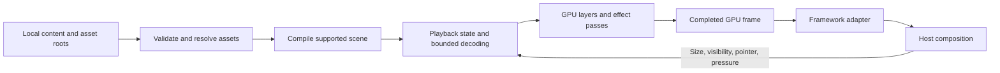

# wallpaper-kit specification

Status: proposed scene design, grounded in inspection of the local MVP package on 2026-10-09. Rust and an initial blank Direct3D 11 renderer with native/headless consumers are now implemented; see [blank infrastructure](../blank-renderer.md). Scene rendering and animation remain unimplemented. Production backend suitability remains subject to the gates below.

## Problem statement

Applications need attractive animated backgrounds without taking over their UI thread, rendering loop, or framework. Wallpaper Engine scenes offer rich existing content, but its renderer is unavailable as an open source library. Reproducing a scene requires interpreting its assets, animation, materials, and composition, rather than playing its preview.

The product is an MIT-licensed, embeddable renderer. Its four requirements are photos, videos, and existing scenes; high quality with bounded resource use; native Windows support; and integration into different application technologies. Compatibility will grow through tested features and scenes.

The first release must render [Yuta Okkotsu | Jujutsu Kaisen, Workshop item 3780699842](https://steamcommunity.com/sharedfiles/filedetails/?id=3780699842). The [inspected package inventory](../research/example-scene-inventory.md) defines this milestone. Broad Wallpaper Engine compatibility is a later objective.

## Solution

Build a Rust library that loads content, owns playback, and renders into GPU textures. A thin Windows viewer exercises the same public API as consuming applications. Framework adapters handle presentation and host lifecycle; they do not implement scene behavior.

The content pipeline is:

### How the four requirements are achieved

| Requirement | Mechanism | Evidence required |
| --- | --- | --- |
| Photos, videos, and existing scenes | Separate content loaders feed a common playback and GPU presentation contract. Scene support is based on explicit feature capabilities. | MVP loads the real scene package. Later milestones add still images and hardware-decoded video with their own fixtures. |
| Lightweight, high quality, performant | Bounded decoding, texture residency, frame queues, and GPU submissions; no background work on the UI thread; explicit quality profiles and visibility controls. | Visual comparison, resource measurements, and host responsiveness tests. Extra threads alone are insufficient. |
| Windows support | Native Rust with Direct3D 11/DXGI as the first backend candidate and Media Foundation for later video support. | Real Windows execution, resize/DPI/device lifecycle tests, and integrated-GPU testing. |
| Integratable into other technologies | Framework-independent library, leased GPU frames, then C ABI and framework-specific adapters. | An early independent native consumer proves presentation. Each production adapter subsequently passes its own lifecycle and latency tests. |

### What the example actually requires

The inspected package has 12 objects: seven image layers, one particle layer, one procedural light-shaft layer, one composition layer, and two sound layers. The scene uses a 3840 × 2160 orthographic canvas, camera parallax, sprite animation, and four effect types: cloud motion, Gaussian blur, light shafts, and chromatic aberration.

Both sprite sequences contain 480 frames at approximately 60 ms per frame, for a 28.8-second loop. The character uses 30 DXT5/BC3 texture pages; the birds use 27 RGBA pages. Two bird layers share the same source asset. No SceneScript, puppet mesh, or video-container requirement was found in this inspection.

This narrows the MVP: implement those visual features, not a JavaScript runtime, general video decoding, or a universal shader translator. The two sound layers remain muted with an explicit diagnostic. Audio playback is outside this visual-renderer MVP.

## User stories

1. As an application developer, I want to load my locally installed example scene so that I can use its actual animation as a background.
2. As a viewer, I want the character and birds to animate at their authored timing so that playback resembles Wallpaper Engine.
3. As a viewer, I want layers, blur, clouds, particles, light shafts, and parallax to compose correctly so that the scene preserves its appearance.
4. As an application developer, I want rendering and asset loading to run outside my UI thread so that input and scrolling remain responsive.
5. As an application developer, I want frame retrieval to return immediately so that a late background frame never delays a UI frame.
6. As an application developer, I want explicit frame-rate, resolution, and memory limits so that I can budget background rendering.
7. As an application developer, I want hidden and minimized backgrounds to stop animating so that they consume less power.
8. As an application developer, I want resize, DPI, pause, resume, and pointer updates so that the background follows my application lifecycle.
9. As an application developer, I want diagnostics naming unsupported features so that I can distinguish compatibility problems from broken assets.
10. As a Windows developer, I want native GPU frames with documented lifetime and synchronization so that I can compose them efficiently.
11. As a maintainer, I want reproducible visual and performance evidence so that compatibility claims can be reviewed.
12. As a maintainer, I want small redistributable fixtures so that automated checks do not depend on proprietary artwork.
13. As a GPUI developer, I want a tested presentation adapter so that my application can consume the library without duplicating rendering logic. This follows the early embedding proof.
14. As an Electron or WebView2 developer, I want a native integration path so that I can use the renderer with my existing UI. Production adapters follow the scene MVP.
15. As an application developer, I want still images to render without a continuous animation loop. General photo support follows the scene MVP.
16. As an application developer, I want hardware video decoding where available, with explicit fallback behavior. Video support follows the scene MVP.

## Implementation decisions

### Language, dependencies, and backend choice

Start with one Rust library, private modules, and a thin viewer. Split crates only when a concrete platform or packaging boundary justifies it. GPUI, Electron, and web runtimes are not dependencies of the core.

| Responsibility | Reuse | Build ourselves |
| --- | --- | --- |
| Windows GPU and presentation | Focused bindings from Microsoft's windows-rs project; Direct3D 11 and DXGI | Resource ownership, render passes, frame exchange, lifecycle handling |
| Structured assets and math | `serde`/`serde_json`, `glam` | Wallpaper Engine schema interpretation, transforms, dependency resolution |
| Image and texture payloads | `image` with only required codecs; `lz4_flex` | PKG/TEX readers, sprite metadata, page indexing and streaming; GPU BC3 upload |
| Errors and instrumentation | `thiserror`, `tracing`, Windows profiling facilities | Compatibility reports, budgets, scenario evidence |
| Scheduling | Standard Rust threads and bounded channels initially | Coalescing, cancellation, playback clock, resource admission |
| MVP shaders | Windows HLSL compiler for our own shaders | Supported material/effect implementations and parameter binding |
| Later video | Windows Media Foundation | Playback, seeking, looping, color conversion and frame scheduling |
| Later adapters | Candidate `cbindgen` and `napi-rs` | Stable ABI, framework lifecycle, presentation and release protocol |

Pin reviewed dependency versions when implementation starts. Reuse mature codecs, compression, math, and OS facilities. Implement the compatibility semantics and ownership rules that are specific to this product.

Direct3D 11 is preferred for a Windows-first MVP because it offers a native composition and texture-sharing route. `wgpu` is the alternative if early experiments show a better total fit. Raw Vulkan adds explicit resource and interop work without yet proving a benefit for this workload. API choice alone does not determine CPU usage, GPU cost, or binary size.

Do not design a generic backend trait before a second backend exists. Keep scene interpretation independent of Windows handles, and isolate GPU operations within the concrete backend so a future port has a clear boundary.

### Asset loading and compatibility

Read the Workshop package and user-supplied engine asset root without modifying either. Resolve package-local assets first, then approved external roots. Validate paths, offset ranges, format versions, dimensions, decoded sizes, and dependency cycles before allocation. References must stay within their permitted roots.

Parse external JSON into validated internal types. Preserve authored object order and recognize irrelevant editor metadata without treating every unknown key as a rendering failure. Unknown visual behavior must produce a diagnostic naming its object, asset, and feature.

Compile the dependency graph into an immutable scene description: layers, transforms, materials, texture references, sprite frame tables, particles, effect passes, and composition points. Keep mutable time, pointer smoothing, particle state, and streaming state in a separate playback instance.

The MVP may require installed Wallpaper Engine assets for built-in material definitions, includes, and utility textures. It must not call the Wallpaper Engine executable or load its cached shader blobs. Report the external dependencies and their hashes. The MVP is therefore an independent renderer, but initially depends on user-provided engine assets. A self-contained compatible asset set is later work.

### Shader and effect strategy

Implement our own HLSL shaders for the inspected generic image/particle materials and four effect types. Interpret the scene's material parameters, masks, pass definitions, and supported shader combinations. Establish the expected behavior from public documentation, asset data, and visual comparison; do not copy decompiled code.

Identify supported shader/effect versions through a compatibility profile. A familiar filename with different source or behavior must not silently select an incorrect implementation. Compile and cache supported shader variants during loading, never during frame presentation.

This is deliberately narrower than arbitrary custom-shader support. Wallpaper Engine has custom preprocessing and legacy GLSL conventions, so dropping its source straight into a modern compiler is insufficient. A later general shader path needs a compatibility frontend and a tested compiler/translation chain; it should reuse existing compiler tools rather than build a compiler from scratch. See the [official shader syntax documentation](https://docs.wallpaperengine.io/en/scene/shader/syntax.html).

### Rendering and playback

Use an orthographic camera, authored layer transforms, UVs, opacity, material blends, and camera parallax. Determine texture color interpretation and blend behavior against the reference; do not assume every pass uses the same color space or alpha convention. Export an explicit SDR color format and alpha mode. HDR is not required by this package.

Render layers in their authored order. Image-local effects process their own layer before composition. A composition layer processes the accumulated image at its position in the scene. In this example, chromatic aberration occurs before the foreground and character, so applying it to the final image would be incorrect.

Use pooled temporary render targets sized to the effect's required extent. Evaluate cloud motion and light shafts using playback time and the inspected parameters. Implement the example's particle emitter, initializers, movement, alpha fade, additive blend, and instance overrides. The production particle clock may be random; fixtures use a fixed seed and bounded simulation steps.

Select sprite frames from accumulated frame durations using a monotonic playback clock. Display frame timing is separate from animation timing: a 30 Hz renderer must not accelerate a sequence authored at about 16.7 frames per second. Pause freezes playback time; resume continues from that time. Seek selects the appropriate texture page and reconstructs particle state under a bounded policy.

When late, advance to the current animation frame instead of building a catch-up queue. Restrict particle catch-up work and report skipped simulation intervals. Pointer events use scene coordinates, remain optional, and are coalesced before parallax smoothing.

### Texture streaming and memory

Do not decode or upload every sprite page. One bird page expands to 248,832,000 bytes; one character page contains 55,259,616 bytes of BC3 data. Eager residency defeats the lightweight requirement before rendering begins.

Index page offsets and frame rectangles at load time. Decode current and soon-needed pages under a byte budget, prefetch before page boundaries, and evict pages that are no longer required. Both bird layers share decoded data and GPU resources. Retain useful mipmaps for static layers.

Prototype full-page residency against extracting only the current frame into a smaller GPU texture. Prefer frame extraction when it reduces memory and upload traffic without breaking atlas sampling. BC3 crops must respect block alignment, UV offsets, frame edges, and filtering; the character's 2001-pixel frame width is not block-aligned. RGBA birds can use row copies of the selected rectangle. Avoid decoding the same page for every displayed frame.

Budget decoded pages, temporary buffers, staging allocations, GPU textures, effect targets, and frame slots separately. GPU copy bandwidth is a cost even when no CPU readback occurs. On prefetch failure or resource pressure, retain the last complete frame and report the miss; do not stall the host or silently omit a layer. Frequent visible stalls fail the playback acceptance test.

### Ownership, concurrency, and public boundary

The public boundary covers renderer creation, asynchronous content loading, playback controls, output size and policy, visibility/pointer updates, compatibility status, metrics, and nonblocking acquisition of a completed frame. Exact Rust signatures follow the presentation prototype.

One render worker owns the Direct3D immediate context and mutable playback state. Initially, one bounded decode worker performs package I/O and decompression. Loading and shader compilation occur outside the host UI thread. Workers share immutable descriptions and bounded messages, not a host-owned rendering context.

Coalesce size, pointer, visibility, and load requests to their latest value. Tag scene changes and decoded work with generations; cancel or discard obsolete results. Define queue-full behavior for each command instead of allowing unbounded messages. An existing scene can continue playing while a replacement loads if both fit the configured budget.

Frame exchange uses a small bounded pool, initially three slots. Each slot progresses through available, rendering, ready, and consumer-held states. Recycle a slot only when consumer GPU use has completed, not merely when a Rust handle is dropped. The host acquires the newest ready frame without waiting; if unavailable, it keeps its previous image. When all slots are held, the producer skips work.

The Windows frame descriptor includes dimensions, format, color/alpha interpretation, GPU adapter identity, resource generation, texture handle, readiness synchronization, and release obligations. Validate same-adapter interop before claiming efficient sharing. Cross-adapter copies are not a transparent fast path.

Prove synchronization with a consumer on a separate D3D device. Keyed mutexes are one candidate; Microsoft documents an immediate-return acquisition with a zero timeout. Never use an indefinite GPU-resource wait on the UI thread. The adapter must also ensure its retained previous image remains valid while the producer progresses. See [DXGI synchronization semantics](https://learn.microsoft.com/en-us/windows/win32/api/dxgi/nf-dxgi-idxgikeyedmutex-acquiresync).

Resize retires old frame generations until their consumers finish. Count retired resources against the budget; delay allocation if necessary. Device loss invalidates affected descriptors and triggers bounded recreation. Shutdown joins workers outside the UI-critical path and closes owned handles. The library must not call UI callbacks from its workers.

### Host integrations

| Consumer | Proposed integration | Gate before claiming support |
| --- | --- | --- |
| Native Rust | Public library plus native GPU presentation | Separate consumer device; frame lifetime, resize, visibility and saturation tests |
| GPUI | Optional Rust adapter importing or composing a Windows GPU surface | Verify the actual GPUI revision and its presentation extension points; a small GPUI change may be needed |
| Electron | Native addon, asynchronous JS controls, shared texture to `VideoFrame` where supported | Pin Electron version; prove synchronization and final-reference release across processes |
| WebView2 | Native background composed beneath a transparent web UI | Verify composition, clipping, DPI and input routing; arbitrary DOM placement is a separate problem |
| Chromium/CEF | Adapter to the embedding application's native compositor | Prove the chosen CEF configuration's texture/composition contract |

Electron's [sharedTexture API](https://www.electronjs.org/docs/latest/api/shared-texture) is experimental and requires the imported texture to remain valid until all references are released. Sending a frame is not permission to overwrite it. GPUI interop also remains unproven; sharing a graphics API does not establish a usable public import API.

Add a C ABI after the frame protocol is proven: opaque handles, explicit create/release functions, versioned descriptors, fixed-width values, and documented threading. Do not expose Rust layouts. A helper process may later isolate failures; it still shares hardware and adds IPC/lifecycle cost. An ordinary browser requires a separate browser backend, not just a native DLL.

### Resource and quality policy

Define two MVP profiles. Reference mode renders at 3840 × 2160 with all inspected visual features, for fidelity review. Background mode initially targets 1920 × 1080 at 30 Hz, with the same scene semantics. Reduced resolution is an explicit output choice, not a compatibility shortcut.

Initial engineering targets below are proposed acceptance thresholds, not measured results or universal hardware guarantees. Before performance work, record the development GPU/driver/CPU and one integrated-GPU test machine. Do not silently relax thresholds after a failure; revise the profile or record a justified specification change.

| Target | Background profile acceptance |
| --- | --- |
| Host API work | Frame acquisition performs no I/O, decoding, shader compilation, GPU readback or blocking wait |
| Steady renderer work | p95 CPU preparation/submission at most 2 ms and p95 GPU render time at most 4 ms per produced frame; decode/upload bursts measured separately |
| Host responsiveness | Against the same host workload without the background, added p95 input-to-present latency at most 1 ms and added p99 at most 2 ms |
| CPU decoded/staging buffers | Admission cap of 768 MiB, including temporary and prefetched sprite pages; total process memory also reported |
| GPU resource allocations | Admission cap of 512 MiB for background mode; driver-reported usage also recorded. Reference-mode allocations reported separately |
| Queueing | At most three output frame slots and bounded pending decode work; no growth with playback duration |
| Hidden/static behavior | No periodic rendering or animation work while hidden or paused after outstanding work settles; retained output remains available |
| Stability | 30-minute looping run, no crashes or increasing cache/handle/queue counts; warm resource counts stabilize after a complete loop |

At 30 Hz, 4 ms of GPU work is already about 12% of a second of GPU time. These are initial ceilings, not an assertion of negligible cost. Record averages, p99 spikes, decode activity, power behavior, and host latency alongside them. A fast GPU-frame result alone cannot establish lightweight operation.

The host can lower frame rate or resolution, pause, or supply pressure signals. The renderer can reduce cadence within the agreed policy and expose its actual output profile. Dropping authored effects or reducing particles requires an explicit reduced-quality policy; reference validation always keeps the required visuals. Integrated GPUs share memory bandwidth with the CPU, so throttling is still needed even with separate threads.

### Later content support

Still images use a decode/upload path and redraw only after content, size, or presentation changes. Start with explicitly listed SDR formats, correct orientation, aspect fit/fill, alpha and color handling. Existing scene texture decoding supplies part of this work but is not itself general photo support.

For video, use Media Foundation with a D3D-aware decoder and GPU-resident surfaces where available. Schedule by media timestamps, drop late frames, and bound decoder output. Implement looping, pause, seek, and YUV conversion. Start with tested MP4/H.264 configurations; query actual decoder availability rather than promise all codecs. Software fallback must be opt-in or reported with its cost. Microsoft's [Direct3D 11 decoder documentation](https://learn.microsoft.com/en-us/windows/win32/medfound/supporting-direct3d-11-video-decoding-in-media-foundation) describes the device integration.

## Testing decisions

### Public test seams

Exercise the library through load, controls, frame acquisition, diagnostics and metrics. A controllable playback clock and particle seed support small deterministic fixtures. Do not expose internal render-pass or parser state solely for tests. Frame capture is an explicit verification operation allowed to use GPU readback; production presentation is not.

Use pure parsing tests for malformed package ranges, invalid dimensions, sprite timing, dependency cycles, and unsupported features. Use redistributable generated fixtures for layer order, blending, masks, two-pass blur, sprite page boundaries, parallax, particles, and composition points. Existing repository research informs scenario reporting; there is no implemented test harness to reuse yet.

### MVP acceptance

The MVP is complete only when all of the following pass:

1. Load the inspected package and resolve its visual dependencies from explicit local roots. Record package and resolved-asset hashes.
2. Render all ten visual objects, including both instances of the birds, all four effect types, masks, particles, correct composition order and pointer parallax. Sound layers are explicitly reported as muted.
3. Play both 480-frame sequences at their authored timing through page transitions and at least two complete loops, without repeated hitches, missing frames from decode failure, or incorrect loop boundaries.
4. Compare native-resolution output and motion to Wallpaper Engine. Review representative sprite phases, a page boundary, foreground composition, particle appearance, and parallax. Exact pixel equality is unsuitable for independently randomized particles; record residual visual differences and their disposition.
5. Exercise load replacement, rapid resize, DPI changes, pause/resume, visibility, missing assets, consumer-held slots, device recreation, and shutdown. Retain valid frames and bounded resources under backpressure.
6. Present frames in an independent native consumer on Windows without a routine GPU-to-CPU transfer. Prove lifetime and synchronization on a separate consumer device. Run a GPUI feasibility experiment and document the supported import path or required changes before promising that adapter.
7. Meet the background-profile resource and latency targets on the declared development machine, and report the same workload on an integrated GPU. A machine that misses targets receives a lower validated profile rather than an unsupported performance claim.
8. Deliver the public library, thin viewer, supported-feature report, source/license notices, and reproducible capture/performance scenarios. No proprietary package, preview or cached shader blob enters the repository.

Each scenario records build identity and local changes, asset identities, OS, GPU/driver/CPU, adapter selection, output size, frame cap, quality policy, clock/seed where applicable, and CPU/GPU/memory/host-latency results. Cold load and warm playback are separate measurements. Compare enabled and disabled host workloads under equivalent settings. Test hardware without Wallpaper Engine simultaneously consuming GPU resources.

### Delivery sequence and decision gates

| Step | Deliverable | Exit evidence |
| --- | --- | --- |
| 1. Confirm compatibility closure | Reproducible inventory, transitive built-in dependencies, material combinations and behavior questions | Every required visual asset and feature accounted for; initial header/timing inspection already completed |
| 2. Prove presentation | Small D3D11 producer and independent consumer; GPUI feasibility experiment | Nonblocking acquisition, safe reuse, resize, stalled-consumer behavior and same-adapter sharing demonstrated; backend decision recorded |
| 3. Load and composite | PKG/TEX loading, static layers, transforms and blends | Actual scene geometry and static appearance reviewed against the reference |
| 4. Animate within budgets | Sprite timing, lazy decoding, page prefetch, bounded resources | Both sequences loop and cross pages without stalls; allocation/upload evidence collected |
| 5. Complete visual behavior | Required effects, particles, parallax and composition | Motion and native-resolution appearance reviewed; unsupported visual feature count is zero |
| 6. Validate MVP | Lifecycle scenarios and host performance evidence | All acceptance checks pass or the specification is explicitly revised with evidence |
| 7. Expand the product | General photos/video, production GPUI adapter, C ABI and other adapters | Separate content/host acceptance suites; expand scene support from new inventories |

Do not start the broad adapter or content matrix before the presentation and example-scene gates. Conversely, do not postpone embedding proof until a standalone renderer is complete.

## Out of scope

- Universal Workshop scene compatibility, arbitrary shader translation, SceneScript, puppet deformation, 3D scenes, web wallpapers, and HDR in the MVP.
- General photo/video playback and production Electron/WebView2/CEF adapters in the first scene milestone.
- Audio playback, audio-reactive features, wallpaper editing, Steam account/download management, and a desktop wallpaper manager.
- Linux/macOS backends, browser/WASM execution, remote streaming, multi-GPU interop, and a helper service in the MVP.
- Copying proprietary executable code or distributing third-party artwork and engine assets without permission.
- Guaranteed zero host impact or a fixed resource promise for arbitrary scenes and hardware.

## Further notes

The highest risks are texture streaming at atlas-page boundaries, fidelity of the four effect implementations, engine asset dependencies, and host texture synchronization. Backend selection and frame signatures remain conditional on the early prototype; the four requirements and example-scene target are fixed.

The package demonstrates why thread count is not the main design decision. Its animations can be expensive through memory and uploads even when their animation rate is modest. A successful implementation limits residency and submission work, measures the actual host, and preserves correct scene behavior under an explicit quality policy.

This specification is stored locally for review. It describes proposed behavior, not existing APIs or working commands. No issue tracker is configured in this repository.
